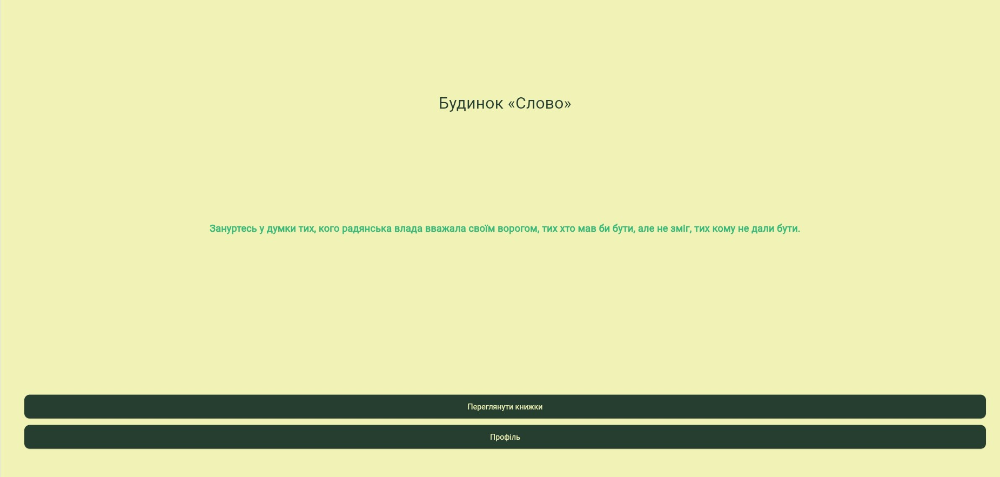
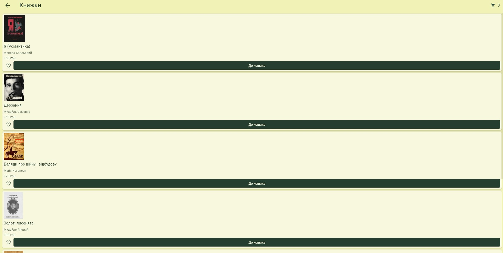
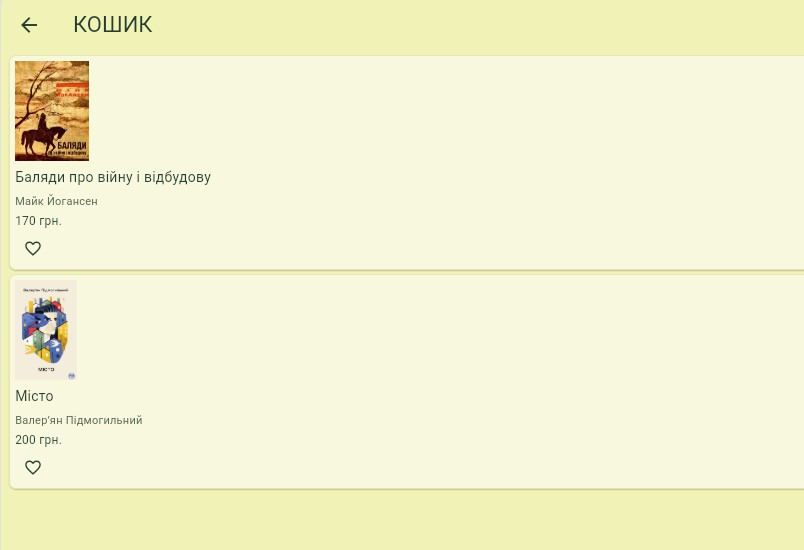
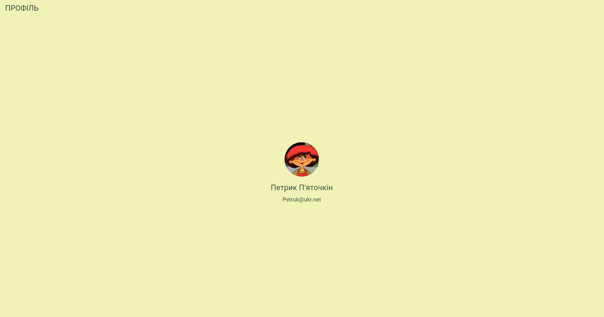

# Будинок «Слово»

Навчальний Flutter-застосунок, створений для практичної роботи №5 «Віджети і компоненти» 

## Опис проєкту

«Будинок “Слово”» — навчальна книжкова крамниця, присвячена українським письменникам Розстріляного відродження, пов'язаним із харківським будинком «Слово».

У застосунку буде представлено шість літературних творів:

1. Микола Хвильовий — «Я (Романтика)»
2. Михайль Семенко — «Дерзання»
3. Майк Йогансен — «Баляди про війну і відбудову»
4. Михайло Яловий — «Золоті лисенята»
5. Микола Куліш — «Мина Мазайло»
6. Вал'ян Підмогильний — «Місто»

Застосунок передбачає перегляд каталогу, додавання книжок до обраного та кошика, перегляд профілю користувача й демонстрацію власних Flutter-віджетів.

## Функціональність застосунку

- Перегляд головного екрана з описом проєкту.
- Перегляд каталогу з шести книжок.
- Відображення обкладинок, назв, авторів і цін.
- Додавання книжок до обраного.
- Додавання книжок до кошика.
- Перегляд вмісту кошика.
- Відображення кількості книжок у кошику.
- Перегляд профілю користувача.
- Збільшення зображення обкладинки книжки.
- Зміна стану обраного за допомогою жесту.
## Використані технології

- Flutter
- Dart
- Material Design
- Git та GitHub
- GitHub Pages
- Figma
- Draw.io

## Запуск проєкту

1. Встановити Flutter SDK.
2. Відкрити папку проєкту у Visual Studio Code.
3. Відкрити термінал.
4. Виконати команди:

```powershell
flutter pub get
flutter run -d chrome
```

## Структура проєкту

- `lib/main.dart` — точка входу в застосунок.
- `lib/screens/` — екрани застосунку.
- `lib/widgets/` — власні віджети.
- `lib/models/` — моделі даних.
- `lib/utils/` — налаштування та керування станом.
- `assets/images/` — зображення книжок і фотографія профілю.
- `screenshots/` — скриншоти застосунку.

### CustomButton

Власна кнопка для взаємодії з користувачем.

### ProductCard

Картка книжки, яка відображає обкладинку, назву, автора, ціну, кнопку обраного та кнопку додавання до кошика.

Реалізовано:
- Додавання до обраного натисканням на серце.
- Зміну стану обраного горизонтальним жестом.
- Збільшення обкладинки натисканням.
- Ефект Shimmer під час завантаження зображення.

### ProfileWidget

Віджет профілю, який відображає фотографію, ім'я та електронну пошту користувача.

Передбачено компактний і розгорнутий режими.

### AnimatedCounter

Власний віджет анімованого лічильника.

## Керування станом

Для керування станом використовується клас `AppState`, який наслідує `ChangeNotifier`.

Він забезпечує:
- Збереження обраних книжок.
- Додавання книжок до кошика.
- Підрахунок кількості книжок у кошику.
- Збереження даних користувача.
- Оновлення інтерфейсу після змін.

## Дизайн у Figma

Для застосунку створено макет інтерфейсу.

[Переглянути дизайн у Figma](https://www.figma.com/design/WnIstLOhWt8Ru6XaRtVNGS/Untitled?node-id=0-1)

## Діаграма архітектури Draw.io

Структуру застосунку представлено у вигляді діаграми.

[Переглянути файл діаграми на GitHub](https://github.com/Maxdana/flutter-widgets-bratishko/blob/main/Budynok_Slovo_Architecture.drawio)


### Головний екран



### Каталог книжок



### Кошик



### Профіль користувача



## Вебверсія застосунку

Застосунок зібрано для вебплатформи та опубліковано за допомогою GitHub Pages.

[Відкрити вебзастосунок](https://maxdana.github.io/flutter-widgets-bratishko/)

## Android-версія

Для застосунку створено APK-файл для Android.

[Завантажити APK із Google Drive](https://drive.google.com/file/d/1oDLxCoZ0B6hPkBL51KED95o0SjtPu9qQ/view?usp=drive_link)

## Репозиторій GitHub

[Переглянути вихідний код](https://github.com/Maxdana/flutter-widgets-bratishko)

## Використання штучного інтелекту

Під час виконання практичної роботи використовувався ChatGPT для пояснення роботи Flutter, допомоги з написанням і виправленням коду, налаштуванням застосунку та підготовкою документації.

Як зробити, щоб після натискання на кнопку відкривався інший екран?


Як додати книжку до кошика, щоб вона там залишалася під час переходу між екранами?


Як змінити кольори кнопок і фону у Flutter?


Як опублікувати готовий Flutter-застосунок на GitHub Pages?